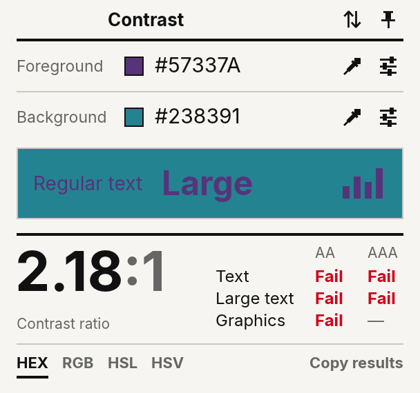
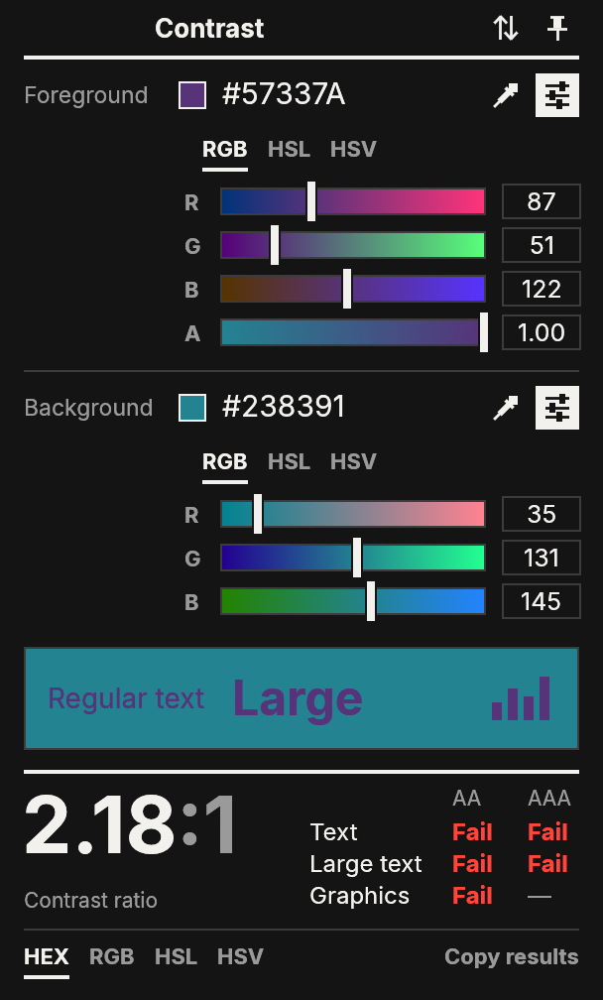
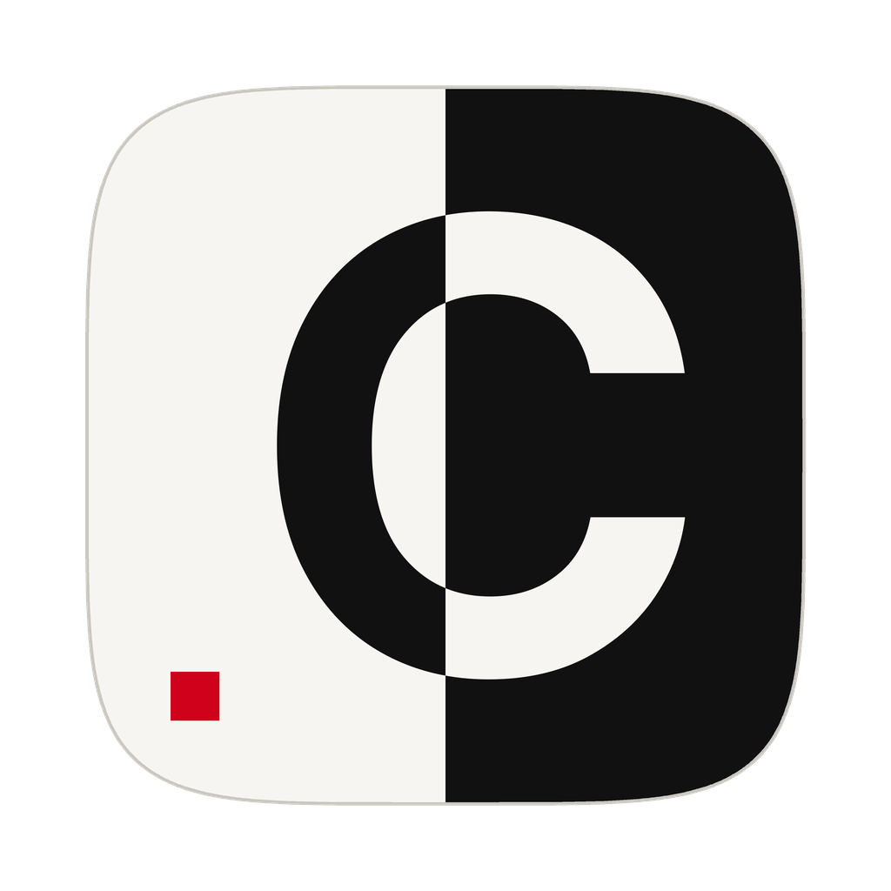

# Contrast

A small, fast colour contrast checker for WCAG 2.1, written in Rust.
It is a compact take on Vispero's
[Colour Contrast Analyser](https://vispero.com/lp/color-contrast-checker/).

<p>
  
  
</p>

## Features

- **Contrast ratio** for a foreground and background colour, with pass/fail for
  - 1.4.3 Contrast (Minimum), AA: 4.5:1 for text, 3:1 for large text
  - 1.4.6 Contrast (Enhanced), AAA: 7:1 for text, 4.5:1 for large text
  - 1.4.11 Non-text Contrast, AA: 3:1 for UI components and graphics
- **Type any colour format** into either field: `#57337A`, `#fff`, `#00000080`,
  `rgb(87, 51, 122)`, `rgba(87 51 122 / 50%)`, `hsl(270, 41%, 34%)`,
  `hsv(270, 58%, 48%)` or plain `87, 51, 122`. HEX / RGB / HSL / HSV in the
  footer sets the format the fields display.
- **Foreground alpha.** A translucent foreground is blended over the background
  before the ratio is calculated, as in CCA.
- **Sliders** for RGB, HSL or HSV. Each slider's track previews the colour you
  get along that channel. Hue and saturation are kept when you pass through grey.
- **Eyedropper (macOS).** Uses the system colour loupe, which doesn't need
  screen-recording permission.
- **Swap** the two colours, **copy results** as plain text, and **keep the
  window on top**.
- **Light and dark** themes follow the system setting. The app's own colours
  pass WCAG AA, and a unit test checks this.

## Running

You need a recent stable Rust toolchain (edition 2024).

```sh
cargo run --release
```

The binary ends up at `target/release/cca`.

### Platforms

macOS is the main target. The app also builds for Windows and Linux (X11 and
Wayland) through eframe. On those platforms the eyedropper button is hidden
and the header sits under the normal title bar.

## Design

The interface uses a Swiss typographic style:

- One grotesk typeface: [Inter](https://rsms.me/inter/), bundled so text looks
  the same on every platform.
- A two-column grid. Labels sit in a narrow left column and values line up in
  the content column.
- Heavy rules split the main sections and hairlines split the rows. Corners are
  square and there are no shadows or gradients, except the slider tracks,
  whose gradients carry information.
- Ink on paper with one red accent, used only for failing results and invalid
  input. Results are always written out as "Pass" or "Fail", so the meaning
  never depends on colour alone.
- Hierarchy comes from size and weight. The ratio is the largest element on
  screen, and its `:1` is muted.

The icon is a "C" split down the middle and inverted across ink and paper,
the contrast pair the app measures, with the UI's single red accent. It is generated from
the bundled Inter Bold by `tools/make_icon.py`.



The window sizes itself to its content and grows when sliders are opened. On
macOS, rendering uses wgpu (Metal) and the render layer is pinned to the
top-left, so the window doesn't flicker or stretch while it resizes.

## How the ratio is calculated

- **Luminance:** the standard WCAG relative-luminance formula on sRGB values
  (linearisation threshold 0.03928).
- **Ratio:** `(L1 + 0.05) / (L2 + 0.05)`.
- **Display:** shown to two decimals and rounded *down*, so a ratio of 4.499 is
  shown as `4.49:1` and never as a passing-looking `4.5:1`. Pass/fail always
  uses the unrounded value.
- **Alpha:** the foreground is composited over the background in sRGB space.

## Development

```sh
cargo test     # colour maths, parsing, formatting, theme contrast
cargo clippy
```

| File            | Contents                                                    |
|-----------------|-------------------------------------------------------------|
| `src/color.rs`  | Conversions, parsing/formatting, luminance and WCAG checks  |
| `src/main.rs`   | UI layout and widgets                                       |
| `src/theme.rs`  | Palette, fonts and egui visuals                             |
| `src/picker.rs` | Screen colour picker (`NSColorSampler` on macOS)            |
| `src/macos.rs`  | Window tweaks that stop auto-resize from flickering         |
| `src/snapshot.rs` | Debug-only: render the window to an image file           |
| `tools/make_icon.py` | Renders `assets/icon.png` (needs Pillow)              |

Debug builds can render themselves to a BMP and exit, which is useful for
checking layout changes without screen-recording permission:

```sh
CCA_SNAPSHOT=out.bmp CCA_THEME=light cargo run          # or CCA_THEME=dark
CCA_SNAPSHOT=out.bmp CCA_SLIDERS=1 cargo run             # with sliders open
```

## Licence

Inter is licensed under the SIL Open Font License 1.1; see
[`assets/fonts/Inter-LICENSE.txt`](assets/fonts/Inter-LICENSE.txt).
